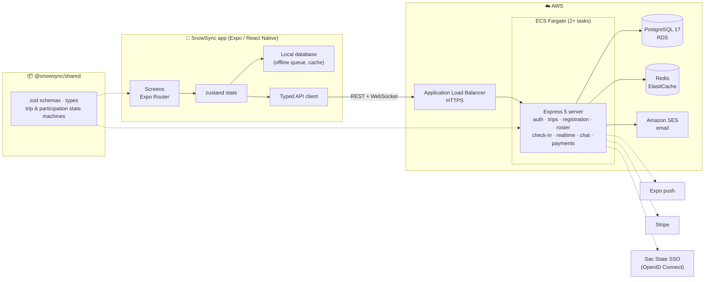
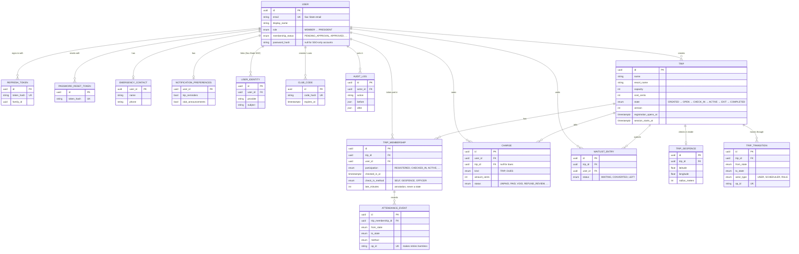
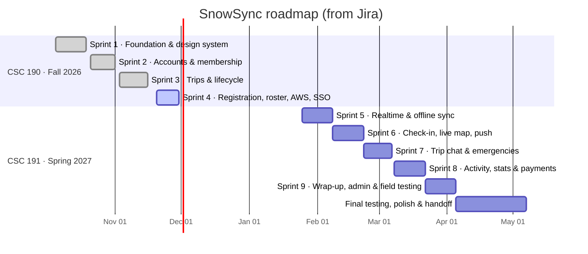

<p align="center">
  
</p>

<p align="center">
  <b>Trips · Registration · Check-in · Live map · Trip chat · Emergency alerts · Dues</b><br>
  CSC 190 / 191 senior project · California State University, Sacramento
</p>

<p align="center">
  
  
  
  
  
  
</p>

---

## Contents

- [Synopsis](#synopsis)
- [Features](#features)
- [Prototype](#prototype)
- [Architecture](#architecture)
- [Data model (ERD)](#data-model-erd)
- [Repository layout](#repository-layout)
- [Developer instructions](#developer-instructions)
- [Testing](#testing)
- [Deployment](#deployment)
- [Timeline](#timeline)
- [Team](#team)

---

## Synopsis

The **Sacramento State Ski & Snow Club** runs its trips across a group chat, a spreadsheet, a payment app and a lot of phone calls. Members miss updates, officers rebuild rosters by hand, and on the mountain nobody knows exactly who has arrived, who is still on the slopes, or how to reach an officer quickly when something goes wrong.

**SnowSync** brings all of that into one mobile app for members and officers:

- **Before a trip:** officers create a trip in a guided form; members browse trips, register for a spot (never more than the trip holds), join a waitlist when it is full, and pay dues and trip charges.
- **On the mountain:** members are checked in automatically when they reach the resort, see their crew on a live map, coordinate in a trip chat that works on weak signal, record their day, and can raise an emergency that reaches every officer at once.
- **After the trip:** attendance is closed out cleanly, season statistics and milestones update, and officers have one place to manage members, payments and announcements.

SnowSync is **offline-first** (actions taken without signal are saved on the phone and delivered later, never twice), **privacy-aware** (location is only shared during an active trip, and members can pause it) and **safety-first** (emergency alerts take priority over everything else).

## Features

| Area                | What members get                                                                          | What officers get                                                          | Status                                          |
| ------------------- | ----------------------------------------------------------------------------------------- | -------------------------------------------------------------------------- | ----------------------------------------------- |
| Accounts            | Sac State email sign-up, sign-in, password reset, onboarding                              | Approve or reject members, one-time club codes, role permissions           | ✅ Done (Fall)                                  |
| Trips               | Browse available, registered and past trips; Home shows what is next                      | Guided trip creation, editing, scheduled lifecycle with early starts       | ✅ Done (Fall)                                  |
| Registration        | Register exactly once, cancel, join a waitlist                                            | Roster with participation, attendance and payment kept separate            | 🚧 Fall Sprint 4                                |
| Check-in            | Automatic check-in at the resort, manual check-in fallback                                | Manual check-in with officer identity and time; late arrivals flagged      | 🚧 Sprint 4 (officer) → Sprint 6 (automatic)    |
| Sign-in             | Continue with Sac State SSO                                                               | —                                                                          | 🚧 Sprint 4 (waiting for Sac State IT approval) |
| Live trip           | Live crew map, pause sharing, trip workspace, push notifications                          | Monitor the trip without leaving their own session                         | 📅 CSC 191                                      |
| Chat & safety       | Trip chat with honest delivery status, emergency button, SMS fallback, incident detection | Instant emergency alerts with last known location, emergency announcements | 📅 CSC 191                                      |
| Activity & payments | Record a ski day, season stats, milestones, pay dues through Stripe                       | Set dues, see who owes, reminders, announcements                           | 📅 CSC 191                                      |
| Wrap-up             | Leave early without ending the trip, clean trip exit                                      | No-show decisions, trip cancellation with refunds, club command center     | 📅 CSC 191                                      |

## Prototype

Every screen is designed first in our Figma product catalog, and the app follows it closely: the Sac State green (`#00573D`), Inter type, quiet cards, and status shown with words and icons, never color alone.

<table>
  <tr>
    <td width="50%" align="center"><br><sub><b>Authentication</b>: Sac State SSO first, with a complete email path</sub></td>
    <td width="50%" align="center"><br><sub><b>Check-in</b>: automatic arrival, manual fallback and the officer attendance view</sub></td>
  </tr>
  <tr>
    <td align="center"><br><sub><b>Registration</b>: duplicate protection, full trips and the waitlist</sub></td>
    <td align="center"><br><sub><b>Trip management</b>: created state, editing and lifecycle controls</sub></td>
  </tr>
  <tr>
    <td colspan="2" align="center"><br><sub><b>Trip roster</b>: participation, attendance and payment shown separately</sub></td>
  </tr>
</table>

## Architecture

One mobile app, one server (a modular monolith), one database. Types and state machines live in a shared package so the app and the server can never disagree about the API.



## Data model (ERD)

The core tables as of Fall Sprint 4. Chat, emergencies, activity recordings and announcements are added in CSC 191 (Sprints 6–8).



## Repository layout

```text
SnowSync/
├── apps/
│   ├── mobile/          # Expo app: app/ (routes), src/features, src/components, src/theme
│   └── server/          # Express server: src/modules/*, prisma/ (schema, migrations, seed)
├── packages/
│   └── shared/          # Types, zod schemas and state machines used by both
├── infra/               # AWS CDK stacks (network, data, service, email, deploy role)
├── .github/workflows/   # CI on every pull request; deploy on main
└── docker-compose.yml   # Local PostgreSQL and Redis
```

## Developer instructions

> 🚧 **Placeholder: to be completed in CSC 191.** The quick start below works today; the full contributor guide comes next semester.

**Quick start**

```bash
# Requirements: Node 24 (see .nvmrc), Docker Desktop, Expo Go or a simulator
git clone https://github.com/eshaw8704/SnowSync.git
cd SnowSync
npm install
cp apps/server/.env.example apps/server/.env      # then set JWT_ACCESS_SECRET
cp apps/mobile/.env.example apps/mobile/.env
npm run db:up                                     # PostgreSQL + Redis in Docker
npm run db:migrate -w @snowsync/server
npm run db:seed -w @snowsync/server               # sample accounts, password: snowsync-dev-password
npm run dev:server                                # http://localhost:3000/health
npm run mobile                                    # Expo
```

**To do in CSC 191**

- [ ] Contributor guide: branch naming (`SS-<key>-slug`), commit format (`SS-123: …`), review and squash-merge rules
- [ ] Architecture decision records for realtime, offline sync and emergency delivery
- [ ] Running on a physical phone (LAN `EXPO_PUBLIC_API_URL`, development builds for background location)
- [ ] Environment variable reference for every service (Stripe, Expo push, SSO, SES)
- [ ] Troubleshooting FAQ

## Testing

> 🚧 **Placeholder: to be completed in CSC 191.**

Every pull request already runs format, lint, typecheck and the unit and integration tests in CI:

```bash
npm run format:check && npm run lint && npm run typecheck && npm test
```

| Package           | Tool                                     | What it covers today                                                 |
| ----------------- | ---------------------------------------- | -------------------------------------------------------------------- |
| `packages/shared` | Vitest                                   | State machines, schemas, contracts                                   |
| `apps/server`     | Vitest + Supertest + real PostgreSQL     | Every endpoint, race conditions (e.g. 30 people racing for 24 spots) |
| `apps/mobile`     | jest-expo + React Native Testing Library | Screens, components, API client                                      |
| `infra`           | Vitest + CDK assertions                  | Synthesized AWS stacks                                               |

**To do in CSC 191 (SS-46)**

- [ ] End-to-end tests of the main flows on real devices
- [ ] Field test on a real mountain: check-in, live map, chat and emergencies on weak signal
- [ ] Offline and reconnect test plan (queued actions delivered once, in order)
- [ ] Security review: auth, permissions, location privacy, payment webhooks
- [ ] Battery and data-usage measurements during an active trip
- [ ] Coverage report and test plan document

## Deployment

> 🚧 **Placeholder: to be completed in CSC 191.**

The infrastructure is defined as code in [`infra/`](infra/) with AWS CDK: a VPC across two availability zones, PostgreSQL (RDS) and Redis (ElastiCache) in private subnets, two or more server tasks on ECS Fargate behind an HTTPS load balancer, Amazon SES for email, and secrets in AWS Secrets Manager. After CI passes on `main`, GitHub Actions signs in to AWS through OIDC (no stored keys), builds the image, runs database migrations once, then rolls the service.

**To do in CSC 191**

- [ ] Production domain, TLS certificate and DNS
- [ ] Staging environment and promotion to production
- [ ] Monitoring, logs and alarms (CloudWatch), backups and restore drill
- [ ] Mobile release: EAS builds, TestFlight and Google Play internal testing
- [ ] Runbook for deploys, rollbacks and on-trip incidents
- [ ] Handoff guide for the club's future officers

## Timeline

Taken from our Jira backlog. Every sprint is about two weeks and about **24 story points** (six developers, 4 points each). Fall 2026 (CSC 190) built the foundation; **Spring 2027 (CSC 191) delivers the live trip, safety, payments and wrap-up features.**



### CSC 191 milestones

| Sprint | Dates                | Milestone                                  | Key stories (Jira)                                                                                                                                                                                                                                                                                                                                     | Points |
| ------ | -------------------- | ------------------------------------------ | ------------------------------------------------------------------------------------------------------------------------------------------------------------------------------------------------------------------------------------------------------------------------------------------------------------------------------------------------------ | ------ |
| **5**  | Jan 25 – Feb 8, 2027 | **Real-time & offline-first**              | SS-39 realtime and local database foundation · SS-22 live server updates · SS-30 one live connection · SS-14 offline actions delivered in order · SS-13 retries never apply twice · SS-45 one picture of live state · SS-47 cached trips with last-updated time · SS-48 connection and pending-update status · SS-51 expired sessions keep cached data | 24     |
| **6**  | Feb 8 – Feb 22       | **On the mountain**                        | SS-81 Sprint 6 foundation · SS-54 automatic geofence check-in · SS-157 live crew map · SS-60 pause and resume sharing · SS-55 active-trip workspace · SS-66 push notifications and inbox · SS-84 just-in-time permissions                                                                                                                              | 24     |
| **7**  | Feb 22 – Mar 7       | **Chat & safety**                          | SS-70 chat and emergency foundation · SS-71 trip chat with honest delivery · SS-88 emergency alert · SS-89 officer emergency response · SS-90 incident detection with 20-second "I'm OK" · SS-91 emergency announcements · SS-92 SMS fallback · SS-56 deep links                                                                                       | 24     |
| **8**  | Mar 8 – Mar 22       | **Activity & payments**                    | SS-57 activity, payment and announcement foundation · SS-58 record a ski day offline · SS-59 automatic recording upload · SS-61 season stats and milestones · SS-62 Stripe dues and trip charges · SS-63 officer dues management · SS-65 club announcements                                                                                            | 24     |
| **9**  | Mar 22 – Apr 5       | **Wrap-up & feature complete**             | SS-67 wrap-up foundation · SS-68 clean trip exit · SS-69 leave early and no-show review · SS-52 trip cancellation and refunds · SS-50 officer command center · SS-53 member management · SS-44 club links and invites · SS-46 end-to-end, field, security and battery testing                                                                          | 24     |
| —      | Apr 5 – early May    | **Release candidate & final presentation** | Bug fixes from field testing, app store test builds, documentation and handoff to the club (date set by CSC 191)                                                                                                                                                                                                                                       | —      |

**CSC 191 total: 39 stories, 120 story points.**

<details>
<summary>Completed in CSC 190 (Fall 2026)</summary>

| Sprint | Dates           | Delivered                                                                                                                                            | Points |
| ------ | --------------- | ---------------------------------------------------------------------------------------------------------------------------------------------------- | ------ |
| 1      | Oct 5 – Oct 19  | Monorepo and CI, shared types, server health check, database migrations, typed API client, tab navigation, design system, loading/empty/error states | 24     |
| 2      | Oct 21 – Nov 1  | Sign-up with Sac State email, sign-in, sessions that renew quietly, password reset, club codes and officer approvals, onboarding                     | 25     |
| 3      | Nov 3 – Nov 16  | Trip data model and state machine, guided trip creation, edit and delete, scheduled lifecycle, trip browsing and Home                                | 24     |
| 4      | Nov 20 – Nov 30 | Registration with capacity protection, cancellation, waitlist, officer roster and check-in, AWS infrastructure, SES email, Sac State SSO             | 24     |

</details>

## Team

Built by six Sacramento State computer science students for the Sac State Ski & Snow Club.

|     | Member          | Fall Sprint 4 focus                                                    |
| --- | --------------- | ---------------------------------------------------------------------- |
| 🎿  | **Shams**       | Registration foundation: data model, participation rules, trip charges |
| 🏔️  | **Elijah**      | Member registration and cancellation, end to end                       |
| 🏂  | **Eshanyadeep** | Officer server features: roster, check-in, waitlist                    |
| ⛷️  | **Ahmad**       | Officer screens: roster, check-in, waitlist                            |
| 🚡  | **Pankaj**      | AWS infrastructure, Docker, deploy pipeline, email                     |
| ❄️  | **Jacob**       | Sac State single sign-on                                               |

<p align="center">
  <br>
  <sub>SnowSync · Sacramento State · CSC 190/191 · 2026–2027</sub>
</p>
